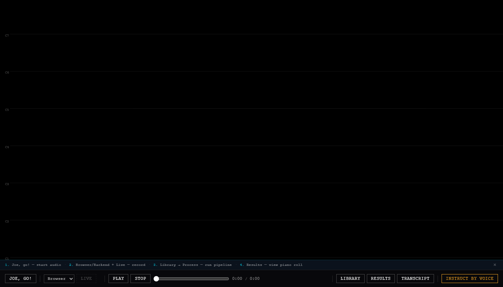
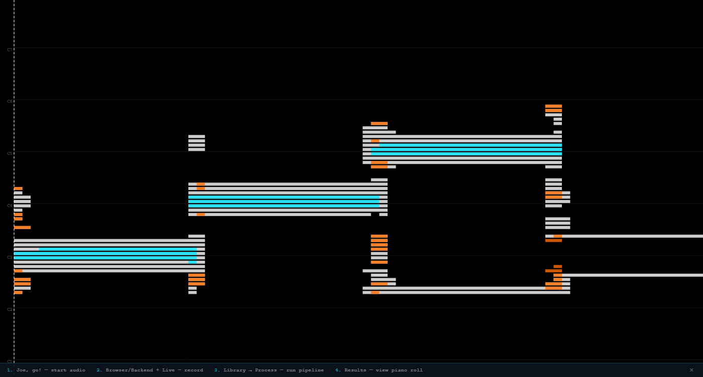

# 03 — In the browser

> **Runtime-bound: joe's API, its Vite dev server, Chromium, and the network.**
> This page starts the real backend and the real dev server on ports of their
> own and drives the page in real Chromium. It fails, rather than skipping,
> when any of them is missing. The network is on the list because the page
> loads p5 from a CDN.

The pages before this one assert the code. This one asserts the screen: a
recording goes in through the API, the pipeline runs on it from the page, and
the piano roll draws what the pipeline found. The pictures are byproducts of
that run — taken from the render the assertions were made against, recorded,
and never compared. Regression protection is the assertions.

## Provisioning

```python
>>> from walkthrough.support import LiveApp, Shots, arpeggio, chromium, painted, until
>>> app = LiveApp().start()
>>> shots = Shots('03-in-the-browser')
>>> browser = chromium()

```

`LiveApp.start()` waits for `/api/health` on the API and for `/joe/` on the dev
server, and raises `Unreachable` if either never answers. The dev server finds
this API through `JOE_API_URL`, the same way it finds qmcp through `QMCP_URL`;
here `QMCP_URL` names a port nobody listens on, so a qmcp running on the
machine cannot put its queue into the picture.

`uv run joe check --url <page> --shots <directory>` runs this page against a
joe that is already up instead: `LiveApp` attaches to the dev server at that
address, reaches the API through its proxy, and starts and removes nothing,
and the pictures go to that directory rather than beside this page.

Both servers and the browser register their own shutdown as they start.
doctest stops at a page's first failing example, so teardown written at the
bottom of a page would be skipped by the run that most needs it.

## The page boots

```python
>>> page = app.open(browser)
>>> page.title()
'Joe | QM'
>>> page.get_by_test_id('start-button').text_content()
'Joe, go!'
>>> page.locator('#canvas-mode').text_content()
''

```

`app.open` waits for p5 to have drawn its canvas, which is the one thing on
this page that comes from the network. Nothing is loaded yet, so the mode badge
is empty and the piano roll has drawn nothing but its guide lines — which are
faint, so none of its pixels is at full strength:

```python
>>> painted(page, 'a > 150')
0
>>> shots.take(page, 'boot')
'03-in-the-browser-boot.png'

```



## A recording, through the pipeline, onto the piano roll

The fixture is four notes — C4, E4, G4, C5, half a second each — made by
`arpeggio()` rather than committed, and handed to the API's upload route, the
one the page's own recorder posts to:

```python
>>> name = app.upload(arpeggio())
>>> name
'capture_....wav'

```

It lands in this checkout's `Data/Audio/`, which git ignores. It, and
everything the pipeline writes for it, is removed when the run ends.

**Library → Process** is the gesture: the Library lists the file, and Process
runs the pipeline on it through `POST /api/run/{filename}`, which starts
`main.py` with `JOE_AUDIO_FILE` naming the file:

```python
>>> page.get_by_test_id('capture-toggle').click()
>>> page.get_by_test_id('capture-refresh').click()
>>> row = page.locator(f'li[data-name="{name}"]')
>>> row.wait_for()
>>> row.locator('[data-action="process"]').click()
>>> until(page, "() => document.getElementById('canvas-mode').textContent === 'RESULTS'",
...       timeout=150_000)

```

The wait is long because the pipeline imports librosa and music21 and draws
its chromagrams before it answers; on a cold machine that is most of a minute.

What the page shows is what the API served. `GET /api/results/latest` returns
the newest `Process_Data` JSON, and the run the page started is it:

```python
>>> served = app.get('/api/results/latest')
>>> track = name.removesuffix('.wav')
>>> list(served['audio']) == [track]
True
>>> sorted(served['audio'][track]['chroma'])
['Harmonic', 'Percussive', 'Raw']
>>> events = sum(len(note['start_dur'])
...              for transform in served['audio'][track]['chroma'].values()
...              for note in transform['midi']['notes'])
>>> events > 0
True
>>> meta = page.get_by_test_id('results-meta').text_content()
>>> f'Notes: {events} events across Raw, Harmonic, Percussive' in meta
True
>>> page.get_by_test_id('transport-name').text_content() == name
True

```

Every event the JSON holds is counted in the panel, and the transport has the
recording loaded to play. The piano roll has drawn them, one colour per
transform — white for Raw, cyan for Harmonic, orange for Percussive — read off
the canvas itself rather than taken on trust. Both panels are then slid out of
the way, and the picture waits until they have gone rather than for a number
of milliseconds:

```python
>>> painted(page, 'a > 150 && r > 200 && g > 200 && b > 200') > 0
True
>>> painted(page, 'a > 150 && r < 60 && g > 180 && b > 200') > 0
True
>>> painted(page, 'a > 150 && r > 200 && g > 60 && g < 160 && b < 80') > 0
True
>>> page.get_by_test_id('results-toggle').click()
>>> page.get_by_test_id('capture-close').click()
>>> until(page, "() => document.getElementById('results-panel')"
...             ".getBoundingClientRect().left >= innerWidth")
>>> until(page, "() => document.getElementById('capture-panel')"
...             ".getBoundingClientRect().right <= 0")
>>> shots.take(page, 'results', of='#piano-roll-canvas')
'03-in-the-browser-results.png'

```



That picture is the piano roll alone. The bar beneath it names the recording,
and the recording's name is a timestamp, so a picture with the bar in it would
differ on every run and say nothing new.

## Nothing went wrong that the page did not show

A browser error reaches neither server's log, so the page's console was kept
from the moment it opened, and so was every request the servers refused:

```python
>>> page.errors
[]
>>> sorted(page.failed)
['500 /v1/human/requests']

```

The one refusal is the voice panel asking qmcp for its queue. The dev server
proxies `/v1` to qmcp, and with nothing behind the proxy it answers 500. A
qmcp that is not running is a normal way to run joe: the queue stays hidden,
and the page asks again less and less often. Every route of joe's own
answered.

## Teardown

```python
>>> page.close()
>>> browser.release()

```

The servers stop, and the fixture and its outputs are removed, when the run
ends — on a failure too.
